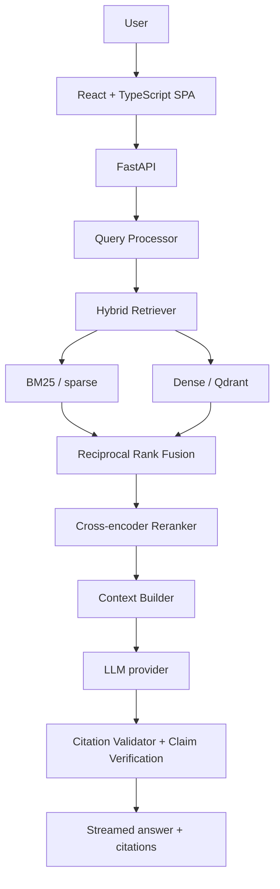
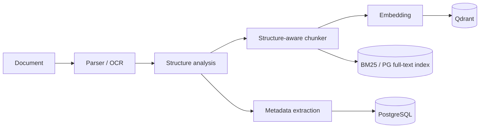

# Research Intelligence

**An AI research workspace: upload papers, then search, question, compare and connect them, with every answer cited to the exact page it came from.**

This isn't a thin wrapper around an LLM API. The retrieval pipeline is implemented and
inspectable end to end: structure-aware parsing and chunking, hand-written BM25, dense
retrieval, Reciprocal Rank Fusion, cross-encoder reranking, context selection, cited
generation, claim-level verification and a retrieval/RAG evaluation framework.

> **Status:** all 16 phases are complete — document ingestion and parsing; chunking, embeddings and a
> Qdrant index; BM25 + dense hybrid retrieval with RRF and cross-encoder reranking; research chat with
> streamed, cited and claim-checked answers; structured paper summaries; 2–5 paper comparisons;
> collections, tags, notes and bookmarks; a knowledge graph with topics, timeline and authors; cited
> literature reviews, research gaps, disagreements and a bounded deep-research agent; a research project
> builder; an evaluation dashboard; usage, cost and latency tracking with caches and Prometheus/Grafana;
> a security review with a cross-tenant test over every route; accessibility and browser end-to-end
> tests; demo mode and a deployment guide. See [PROGRESS.md](PROGRESS.md) for the log and
> [docs/ROADMAP.md](docs/ROADMAP.md) for the plan.

## Architecture





Details, including the database schema, API design, decisions, bottlenecks and risks, are in [docs/ARCHITECTURE.md](docs/ARCHITECTURE.md).

## Tech stack

| Layer | Technology |
|---|---|
| Backend | Python 3.12, FastAPI, Pydantic v2, SQLAlchemy 2 (async), Alembic |
| Data | PostgreSQL (SQLite for local dev), Redis, Qdrant |
| Jobs | Celery + Redis (or in-process for local dev) |
| AI / ML | PyTorch, Transformers, sentence-transformers, NetworkX, PyMuPDF; clustering (K-Means, agglomerative, HDBSCAN) hand-written in NumPy |
| Frontend | React 19, TypeScript, Vite, Tailwind CSS v4, TanStack Query, Zustand, Radix UI |
| Infra | Docker Compose, nginx, GitHub Actions, structured JSON logging, Prometheus metrics |

## Quick start

**Without Docker** (SQLite, in-process jobs):

```bash
# Windows
powershell -ExecutionPolicy Bypass -File scripts/dev.ps1
# macOS / Linux
./scripts/dev.sh
```

Then open http://localhost:5173, create an account and press **Try sample papers** to load three
synthetic papers (or upload your own). The default language model is Ollama `qwen2.5:3b`
(`ollama pull qwen2.5:3b`); everything else runs locally without API keys.

**Just want to use it on your own computer, with your own model?** Run
`scripts/run-local.ps1` (Windows) or `./scripts/run-local.sh` (macOS / Linux): it checks what's
installed, sets everything up once, pulls the model into Ollama and starts the app. See
[docs/RUN_LOCALLY.md](docs/RUN_LOCALLY.md). On any copy, **Settings → AI** lets each user keep the
server's model, bring their own API key (OpenAI, Gemini, Groq, OpenRouter, Mistral —
stored encrypted, never shown again) or use a model on their computer.

**Running it as a public site?** It can offer everyone a free shared model through the site's own
key (NVIDIA Nemotron 3 Ultra on OpenRouter is the worked example): opt-in per user, paced, with a
daily allowance — see "A free model for everyone" in [docs/DEPLOYMENT.md](docs/DEPLOYMENT.md).
Nothing a user adds is public or visible to another account, administrators included; what that
does and doesn't cover is in [docs/SECURITY.md](docs/SECURITY.md) (Privacy).

**With Docker** (PostgreSQL, Redis, Qdrant, Celery workers):

```bash
cp .env.example .env
docker compose up --build        # http://localhost:8080
```

See [docs/DEVELOPMENT.md](docs/DEVELOPMENT.md) for manual setup, tests and conventions.

## Documentation

| Doc | Contents |
|---|---|
| [PROGRESS.md](PROGRESS.md) | Session-by-session progress log and current status |
| [docs/RUN_LOCALLY.md](docs/RUN_LOCALLY.md) | Run your own copy with a local model, or use your own API key |
| [docs/ROADMAP.md](docs/ROADMAP.md) | 16 phases plus suggested additions |
| [docs/ARCHITECTURE.md](docs/ARCHITECTURE.md) | System design, schema, API, RAG pipeline, decisions, risks |
| [docs/DEVELOPMENT.md](docs/DEVELOPMENT.md) | Setup, testing, migrations, conventions |
| [docs/SECURITY.md](docs/SECURITY.md) | Threat model, security controls and where they are tested |
| [docs/DEPLOYMENT.md](docs/DEPLOYMENT.md) | Production deployment, HTTPS, demo instance, monitoring, backups, upgrades, scaling |
| [docs/ACCESSIBILITY.md](docs/ACCESSIBILITY.md) | Accessibility audit results and support |
| [docs/EVALUATION.md](docs/EVALUATION.md) | Evaluation datasets, retrieval and answer metrics, how runs are compared |
| [docs/OBSERVABILITY.md](docs/OBSERVABILITY.md) | Usage and cost tracking, latency per stage, caches (incl. the semantic answer cache), Prometheus/Grafana |

The API is documented interactively at `/docs` (OpenAPI); the AI pipeline is described in
[docs/ARCHITECTURE.md](docs/ARCHITECTURE.md#6-ai--rag-pipeline-design).
