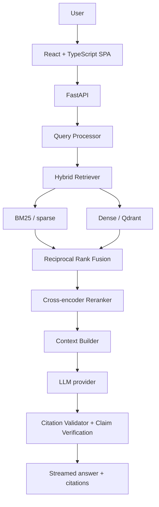
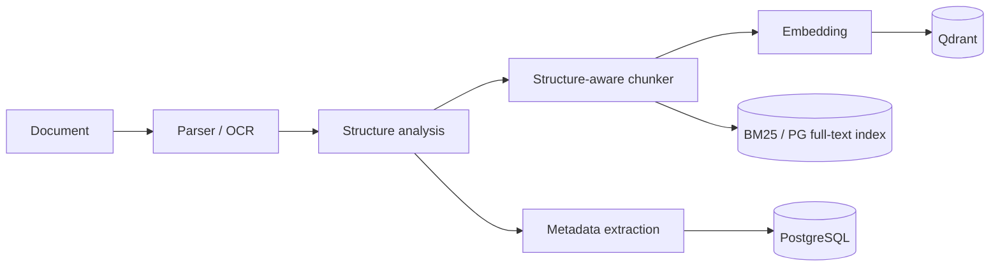

# Research Intelligence

An AI workspace for reading and interrogating research papers. Upload a PDF, ask it a
question, and get an answer with a citation pointing back to the exact page and passage
it came from — not a summary that sounds plausible, an answer you can check.

The retrieval layer isn't a thin wrapper around someone else's API. Chunking, BM25,
dense search, rank fusion and reranking are all implemented in this codebase, which is
the only reason it's possible to inspect, tune, and actually evaluate how search behaves
instead of trusting whatever a hosted service decides to return.

## What's in it

- **Ingestion** for PDF, DOCX, HTML, Markdown and plain text, plus direct import by
  arXiv id or DOI. Dedup by file hash, DOI/arXiv id, or title similarity; re-uploading a
  paper keeps version history instead of silently overwriting it.
- **Structure-aware chunking** — five strategies (fixed, recursive, sentence,
  section-aware, semantic), with section-aware as the default so a chunk never crosses a
  section boundary.
- **Hybrid retrieval**: a hand-written Okapi BM25 index, dense search over Qdrant, fused
  with Reciprocal Rank Fusion, then reordered by a cross-encoder reranker. The Search
  page has a debug panel that shows exactly how each result was found — which retriever
  surfaced it, at what rank, and what the reranker did to it.
- **Research chat** with streamed, cited answers. Every citation is checked against the
  passage it points to, and each claim gets an entailment check (supported / partial /
  unsupported) instead of a flat confidence number.
- **Paper summaries**, 2–5 paper comparisons, a knowledge graph with entity extraction
  and clustering, author/dataset/method analysis, and a timeline view.
- **Literature reviews, research gaps, and disagreement detection**, plus a bounded
  deep-research agent: it plans a handful of sub-questions, searches the library with a
  read-only tool, answers each one from numbered passages, and writes a conclusion from
  what it actually cited — under a fixed step count and timeout, with the whole trace
  visible in the UI.
- **A research project builder** that turns an idea into questions, a method plan, an
  experiment plan, and a runnable starter project — real baseline implementations
  (BM25, DPR, Contriever, a cross-encoder reranker) wired to tested metrics, not
  placeholder code.
- **Research Watches**: save a topic and an interval, and the app periodically searches
  arXiv, scores new papers against it, optionally imports what clears the threshold, and
  sends a digest in-app or to Slack/Discord. No daily check-in required.
- **An evaluation framework** for comparing retrieval and RAG configurations against your
  own papers and questions (`docs/EVALUATION.md`), plus a separate benchmark against BEIR
  SciFact for numbers you can cite outside this app (`eval/beir/`).

Everyone's data stays theirs: each user can use the server's configured model, bring
their own API key, or point at a model running on their own machine, and a cross-tenant
test suite checks that no route leaks another user's documents.

## How retrieval works





A paper goes in once through parsing and structure analysis, then gets chunked and
embedded. A query goes through BM25 and the dense index in parallel, gets fused, and the
top candidates get reranked before anything is sent to the model. Full design decisions,
the schema, and known bottlenecks are in `docs/ARCHITECTURE.md`.

## Tech stack

| Layer | Technology |
|---|---|
| Backend | Python 3.12, FastAPI, Pydantic v2, SQLAlchemy 2 (async), Alembic |
| Data | PostgreSQL (SQLite for local dev), Redis, Qdrant |
| Jobs | Celery + Redis (or in-process for local dev); an asyncio scheduler for Research Watches |
| AI / ML | PyTorch, Transformers, sentence-transformers, NetworkX, PyMuPDF; BM25 and clustering (K-Means, agglomerative, HDBSCAN) written directly over NumPy |
| Frontend | React 19, TypeScript, Vite, Tailwind CSS v4, TanStack Query, Zustand, Radix UI |
| Infra | Docker Compose, nginx, GitHub Actions, structured JSON logging, Prometheus metrics |

## Getting started

Without Docker, using SQLite and in-process jobs:

```bash
# Windows
powershell -ExecutionPolicy Bypass -File scripts/dev.ps1
# macOS / Linux
./scripts/dev.sh
```

Open http://localhost:5173, create an account, and either load the sample papers or
upload your own. The default model is Ollama's `qwen2.5:3b` (`ollama pull qwen2.5:3b`);
everything else runs locally with no API keys involved.

Want it fully set up for you, including pulling the model? Run `scripts/run-local.ps1`
(Windows) or `./scripts/run-local.sh` (macOS/Linux) — see `docs/RUN_LOCALLY.md`.

Prefer to do each step yourself, or the script doesn't fit your setup? [`INSTALL.md`](INSTALL.md)
has the full manual procedure, backend and frontend separately, plus a Docker Compose path.

With Docker (PostgreSQL, Redis, Qdrant, Celery, the isolated code runner):

```bash
cp .env.example .env
docker compose up --build        # http://localhost:8080
```

Any user can also skip local models entirely and bring their own API key (OpenAI,
Gemini, Groq, OpenRouter, Mistral) from Settings → AI, or point at a model on their own
network.

## Documentation

| Doc | Contents |
|---|---|
| [INSTALL.md](INSTALL.md) | Manual, step-by-step install — no scripts |
| [FEATURES.md](FEATURES.md) | Full feature catalog, in detail |
| [PROGRESS.md](PROGRESS.md) | Build log and current status |
| [docs/ARCHITECTURE.md](docs/ARCHITECTURE.md) | System design, schema, API, the RAG pipeline, decisions and risks |
| [docs/DEVELOPMENT.md](docs/DEVELOPMENT.md) | Setup, testing, migrations, conventions |
| [docs/EVALUATION.md](docs/EVALUATION.md) | Retrieval and answer metrics, how configurations are compared |
| [docs/SECURITY.md](docs/SECURITY.md) | Threat model and where each control is tested |
| [docs/DEPLOYMENT.md](docs/DEPLOYMENT.md) | Production deployment, HTTPS, backups, scaling |
| [docs/ACCESSIBILITY.md](docs/ACCESSIBILITY.md) | Accessibility audit and support |
| [docs/OBSERVABILITY.md](docs/OBSERVABILITY.md) | Usage/cost tracking, latency, caching, Prometheus/Grafana |

The API is also documented at `/docs` (OpenAPI) once the backend is running.

## Tests

```bash
cd backend && python -m pytest        # 648 tests by default
cd frontend && npm test               # 170 unit tests
cd frontend && npm run e2e            # Playwright, Chromium
```

Tests that need a downloaded model are opt-in (`RUN_MODEL_TESTS=1`) so the default suite
never pulls model weights or needs a database service. `ruff`/`mypy` for the backend and
`oxlint`/`tsc` for the frontend run clean; CI (`.github/workflows/ci.yml`) runs all of it
plus a migration up/down/up check against a real PostgreSQL instance.

## Running your own instance for other people

A copy reachable by anyone other than you is a server, not a local tool — see
[docs/DEPLOYMENT.md](docs/DEPLOYMENT.md) before exposing one, and
[docs/SECURITY.md](docs/SECURITY.md) for what's covered (and what isn't) around user
data and isolation.
