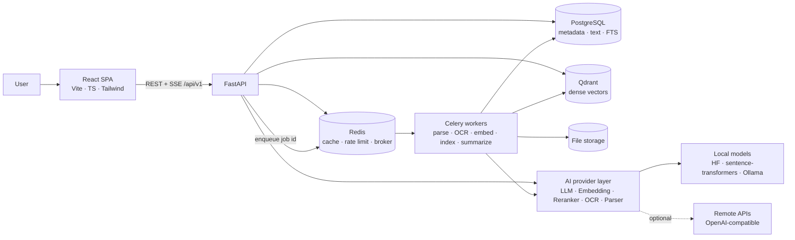
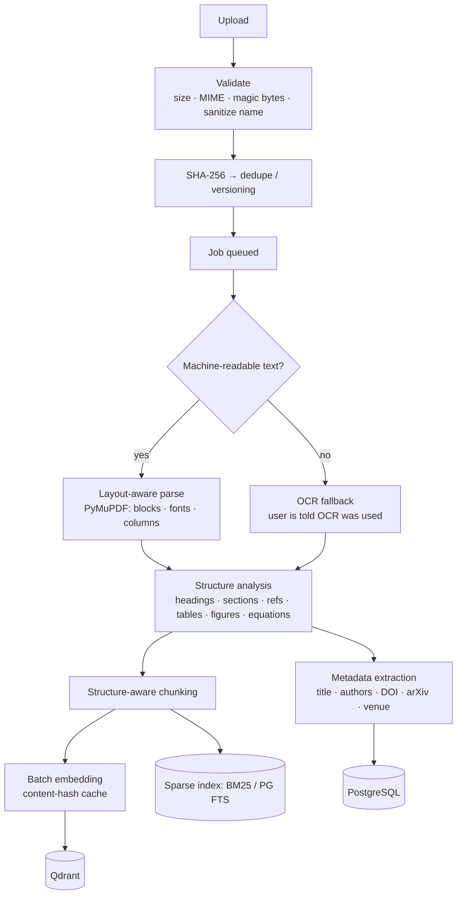
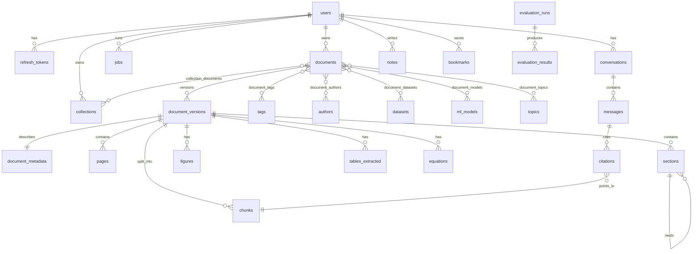

# Architecture

This document is the technical design of the AI Research Intelligence Platform:
services, data model, API surface, the AI/RAG pipeline, bottlenecks, risks, and
the reasoning behind each major decision. Sections marked **(planned)** describe
the target design for later phases; see [ROADMAP.md](ROADMAP.md) for status.

---

## 1. System overview



### Query path (planned, Phases 4–6)

```mermaid
flowchart TD
    Q[User question] --> QP[Query processor<br/>intent · entities · filters]
    QP --> EXP{Needs expansion?}
    EXP -->|yes| QE[Query expansion<br/>guarded against drift]
    EXP -->|no| HR
    QE --> HR[Hybrid retriever]
    HR --> BM[BM25 / sparse]
    HR --> DN[Dense / Qdrant]
    BM --> RRF[Reciprocal Rank Fusion<br/>Σ 1/(k + rank)]
    DN --> RRF
    RRF --> RR[Cross-encoder reranker<br/>top 50–100 → top 10–20]
    RR --> CS[Context selection<br/>dedupe · MMR diversity · token budget]
    CS --> LLM[LLM generation<br/>evidence-only prompt, numbered sources]
    LLM --> CV[Citation validator + claim verification]
    CV --> RESP[Streamed answer + citations + support status]
```

### Ingestion path (planned, Phases 2–3)



---

## 2. Services and responsibilities

| Layer | Location | Responsibility |
|---|---|---|
| API | `backend/app/api/` | HTTP routing, request validation, auth dependencies, error shaping. No business logic. |
| Services | `backend/app/services/` | Use-cases (auth, jobs, ingestion, retrieval, generation, citations, evaluation, KG). |
| Repositories | `backend/app/repositories/` | Data access only (SQLAlchemy queries). |
| Models / Schemas | `backend/app/models/`, `schemas/` | ORM tables; Pydantic request/response contracts. |
| Workers | `backend/app/workers/` | Job registry, runner, dispatchers (inline or Celery). |
| Core | `backend/app/core/` | Config, logging, DB engine, security, metrics, rate limiting, errors. |
| AI providers | `backend/app/services/embeddings/` ✅ (Phase 3), `generation/`, `reranking/` (planned) | One interface per capability; implementations are swappable by config. `services/models/manager.py` owns local model lifecycle (device/dtype, lazy load, LRU + idle unload). |
| Frontend | `frontend/src/` | Pages, design-system components, typed API client, stores. No business logic in components. |

### Provider abstraction (planned, Phases 2–6)

```python
class LLMProvider(Protocol):
    name: str
    async def generate(self, messages: list[Message], *, params: GenerationParams) -> Generation: ...
    def stream(self, messages: list[Message], *, params: GenerationParams) -> AsyncIterator[Delta]: ...
    def count_tokens(self, text: str) -> int: ...

class EmbeddingProvider(Protocol):
    model_id: str      # recorded with every vector
    dimension: int
    async def embed_documents(self, texts: list[str]) -> np.ndarray: ...
    async def embed_query(self, text: str) -> np.ndarray: ...   # E5/BGE need different prefixes

class RerankerProvider(Protocol):
    async def rerank(self, query: str, passages: list[str]) -> list[float]: ...

class OCRProvider(Protocol): ...
class ParserProvider(Protocol): ...   # one per format: pdf, docx, html, md, txt
```

Implementations: `OpenAICompatibleProvider` (covers OpenAI, vLLM, LM Studio, Together…),
`OllamaProvider`, `LocalHFProvider`. A `ProviderRegistry` builds
them from settings; `LOCAL_ONLY=true` makes the registry refuse remote providers.
A `ModelManager` lazy-loads local models, picks device (CUDA if available) and dtype,
and unloads idle models (LRU) so a laptop GPU never holds embedder + reranker + LLM at once.

---

## 3. Key decisions (and why)

| Decision | Rationale |
|---|---|
| **FastAPI + async SQLAlchemy 2** | Native async for I/O-heavy LLM/vector calls; Pydantic contracts double as OpenAPI docs. |
| **PostgreSQL as system of record** | Relational integrity for ownership/citations; built-in FTS (`tsvector`) gives a second sparse retriever without another service. |
| **Own BM25 implementation + PG FTS** | BM25 is written by hand (inspectable, testable, tunable k1/b) and PG FTS is the scalable path. Both behind a `SparseRetriever` interface. |
| **Qdrant for dense vectors** | Payload filtering (user, collection, year, section) at query time is essential for filtered retrieval; embedded mode for local dev, server in Docker. |
| **RRF for fusion** | Rank-based, no score calibration needed between BM25 and cosine scores; `k` configurable, fusion behind an interface (weighted/CombSUM later). |
| **Celery + Redis, with inline fallback** | Parsing a 300-page PDF must not block API workers. The `JobDispatcher` interface lets tests and laptops run jobs in-process with zero infra. |
| **Job state in PostgreSQL, not Celery results** | The UI polls one table for progress/errors; survives broker restarts; user-scoped. |
| **Dispatch after commit** | Jobs are dispatched via a post-commit hook, so a worker never picks up a job whose rows aren't visible yet. |
| **Refresh token in httpOnly SameSite=Strict cookie; access token in memory** | Tokens are never readable by JS storage (XSS-resistant). Refresh tokens are opaque, stored hashed, rotated on use, and replay of a rotated token revokes all sessions. |
| **Argon2id password hashing** | Memory-hard; OWASP-recommended; transparent rehash on login when parameters change. |
| **SQLite + embedded services for local dev** | `git clone → run` works without Docker. Types chosen to be portable (`Uuid`, `JSON→JSONB`); CI runs migrations on real PostgreSQL. |
| **Dependency-free metrics with Prometheus exposition** | `/metrics` is scrape-ready today; swapping to `prometheus_client` touches one module. |
| **No LangChain/LlamaIndex in the core** | The retrieval pipeline must be inspectable and explainable in an interview. Libraries are used for models, not orchestration. |
| **Support status instead of "confidence %"** | Supported / partially supported / insufficient evidence is derived from claim-level verification — a defensible signal, unlike a made-up percentage. |

---

## 4. Database schema

Implemented: `users`, `refresh_tokens`, `jobs`, `audit_logs` (Phase 1); `documents`, `document_versions`, `document_metadata`, `pages`, `sections`, `document_elements`, `document_references` (Phase 2).
Everything else is the target design, added with the phase that needs it
(migrations are generated per phase).



| Table | Key columns | Notes / indexes |
|---|---|---|
| `users` ✅ | id, email (unique), password_hash (nullable → OAuth later), preferences JSONB | |
| `refresh_tokens` ✅ | user_id FK CASCADE, token_hash (unique), expires_at, revoked_at, replaced_by_id | `(user_id, revoked_at)` |
| `jobs` ✅ | user_id, kind, status, stage, progress, subject_type/id, payload, result, error_message, error_detail, attempts | `(user_id, status)`, `subject_id` |
| `audit_logs` ✅ | user_id (SET NULL), action, resource, request_id, details | `(user_id, created_at)` |
| `documents` | user_id, title, status, current_version_id, file_hash, doc_type, duplicate_of_id, duplicate_kind, reading_status | `(user_id, file_hash)`, `(user_id, status)` |
| `document_versions` | document_id, version, file_path, file_hash, page_count, used_ocr, processing_config JSONB, embedding_model, embedding_dimension, chunking_strategy, chunk_count, indexed_at | unique `(document_id, version)` |
| `document_metadata` | version_id, title, normalized_title, authors JSONB, abstract, year, venue, doi, arxiv_id, keywords, extraction_source, user_corrected | `doi`, `arxiv_id`, `normalized_title` for dedupe |
| `pages` | version_id, number, width, height, text, used_ocr | |
| `sections` | version_id, parent_id, kind (abstract/methods/…), title, level, order, page_start/end, char_start/end | self-FK for hierarchy |
| `chunks` ✅ | version_id, document_id, user_id, section_id, page_start/end, paragraph_index, chunk_index, char_start/end, text, context_header, section_title/kind, token_count, content_hash, strategy, kind (text/table/caption/equation), boxes | `content_hash`, unique `(version_id, chunk_index)`, `(user_id, document_id)`; GIN `tsvector` in Phase 4 |
| `embedding_cache` ✅ | PK `(model_id, text_hash)`, dimension, vector bytes | Keyed by the exact embedded text, not the chunk: identical text across versions/re-uploads/reprocessing is never re-embedded, and Qdrant can be rebuilt without recomputing. The Qdrant point id is the chunk id. |
| `figures` / `tables_extracted` / `equations` | version_id, page, label ("Figure 3"), caption, content (table as JSON grid / LaTeX), bbox | |
| `collections`, `collection_documents` | user_id, name, kind (project/review/thesis/course) | |
| `tags`, `document_tags` | user-scoped tag names | unique `(user_id, name)` |
| `entities` | type (dataset / model / method / metric / task), key (normalized name), name, aliases, info (built-in catalog facts only), source (catalog / discovered) | unique `(user_id, type, key)` · ✅ Phase 10 |
| `document_entities` | document_id, version_id, entity_id, relation (proposes / uses / mentions), mentions, score, variants ("BERT-large"), evidence JSON (sentence, page, section, paragraph) | unique `(version_id, entity_id)`, `(user_id, entity_id)` · ✅ Phase 10 |
| `entity_extractions` | PK version_id; extractor_version, title, discovered JSON (names found in this paper alone), dictionary_hash (library dictionary it was matched with), stats | re-match only when the library dictionary changes *and* a changed name occurs in the paper · ✅ Phase 10 |
| `topic_clusterings` | method, params, fingerprint (embedding model + current version ids → stale detection), result JSON (clusters with terms / entities / names, 2-D points, quality), naming_status, naming_model, job_id | `(user_id, created_at)` · ✅ Phase 10. Authors, institutions and in-library citations are derived from metadata and parsed references on read (they always follow metadata corrections). |
| `research_reports` | kind (review / gaps / disagreements / deep_research), title, query, params (papers, collection, depth, agent limits), document_ids used, status, job_id, sections JSON (text with [n] citations, claims with check status, or data: comparison rows, chronology, disagreements, gaps, directions), sources (one numbering per report), support, trace (papers chosen, summaries written, model replies, agent steps), generation_config, edited_at | `(user_id, created_at)` · ✅ Phase 11 |
| `conversations`, `messages` | scope (paper/library/collection), collection_id, role, content, retrieval_trace JSONB, generation_config JSONB, token usage, cost | |
| `collections`, `collection_documents` | name, description, kind (project / review / thesis / course); papers with added_at | `(user_id, updated_at)` · ✅ Phase 9 |
| `tags`, `document_tags` | name, normalized (casefolded, unique per user), color | unique `(user_id, normalized)` · ✅ Phase 9 |
| `notes` | document_id or collection_id, Markdown content, anchor JSON (paper / page / passage / citation: page, char offsets, quote, boxes, chunk, message) | `(user_id, updated_at)` · ✅ Phase 9 |
| `bookmarks` | document_id, kind (paper / passage / table / figure / citation), target JSON snapshot, label, key | unique `(user_id, key)` (one bookmark per thing) · ✅ Phase 9 |
| `citations` | message_id, chunk_id, document_id, page, section, quote, score, support_status | |
| `comparisons` | title, kind, document_ids (column order), status, job_id, config_key, columns, rows JSON (cells with text, citations, status, claims; row agreement), sources (numbered across papers), overview, support, generation_config, trace | ✅ Phase 8 |
| `paper_extractions` | document_id, version_id, kind, config_key (version + kind + model + prompt version), sections, sources, claims, trace — one paper's cells, reused by every comparison it appears in | ✅ Phase 8 |
| `paper_summaries` | document_id, version_id, status, job_id, config_key (version + model + prompt version), sections JSON (text, citations, status, claims), sources JSON (passage snapshots), support, generation_config, trace (passages chosen, raw replies), tokens, latency | ✅ Phase 7 |
| `notes`, `bookmarks` | user_id, target_type (paper/page/passage/citation/table/figure), target_id, anchor JSONB, markdown body | |
| `llm_usage` | user_id (CASCADE), feature (chat / summary / comparison / report / project / topics / evaluation), job_id, provider, model, input/output tokens, estimated, latency_ms, first_token_ms, cost_usd (priced at call time), status (ok / error / stopped) | `(user_id, created_at)` · ✅ Phase 14. Written by `MeteredLLM` around every model call; also the source of the Prometheus usage series. |
| `eval_datasets` | name, description, generation JSON (status / requested / created / skipped of the last question draft) | `(user_id, created_at)` · ✅ Phase 13 |
| `eval_items` | dataset_id, question, expected JSON (spans: document_id, version_id, char_start/end, page, quote, title — not chunk ids, so they survive re-chunking), reference_answer, source (manual / generated), status (verified / unverified) | `(dataset_id, created_at)` · ✅ Phase 13 |
| `eval_runs` | dataset_id, name, kind (retrieval / rag), config (retriever, rerank, k values + snapshot of index, reranker, LLM, verifier), status, job_id, metrics (means + latency percentiles, throughput, tokens, cost), per_item, items_evaluated, latency_ms, error_message | `(user_id, created_at)` · ✅ Phase 13. A run *is* the experiment: its config is the named configuration, compared on the Compare tab. |

Reproducibility: every generated artifact (message, summary, review, evaluation run)
stores a `generation_config` snapshot: model + version, embedding model, chunking
strategy, retrieval settings, reranker, temperature, timestamp.

---

## 5. API design

REST under `/api/v1`, OpenAPI at `/docs`. Errors always have the shape
`{"error": {"code", "message", "hint", "request_id", "details"}}`.

| Area | Endpoints | Status |
|---|---|---|
| System | `GET /health`, `GET /ready`, `GET /metrics`, `GET /api/v1/config`, `GET /api/v1/metrics/summary` | ✅ |
| Auth | `POST /auth/register`, `/auth/login`, `/auth/refresh`, `/auth/logout`, `/auth/change-password` | ✅ |
| Account | `GET/PATCH/DELETE /users/me` (delete also removes files and vectors), `GET /users/me/sessions`, `DELETE /users/me/sessions/{id}`, `GET /users/me/activity` (security activity), `GET /users/me/export` (.zip: JSON of everything owned + original files) | ✅ |
| Jobs | `GET /jobs`, `GET /jobs/{id}`, `POST /jobs/{id}/retry` | ✅ |
| Documents | `POST /documents` (multipart, multi-file), `GET /documents`, `GET/PATCH/DELETE /documents/{id}`, `POST /documents/{id}/process`, `GET /documents/{id}/status`, `GET /documents/{id}/file`, `GET /documents/{id}/pages/{n}`, `GET /documents/{id}/structure`, `PATCH /documents/{id}/metadata`, `GET /documents/{id}/versions`, `POST /documents/{id}/duplicate-resolution`, `GET /documents/stats`, signed `GET /assets/versions/{id}/…` | ✅ |
| Search | `POST /search` (mode: keyword/semantic/hybrid, filters, limit, candidates, rerank, `debug=true` → full trace), `GET /search/facets`; `GET /documents/{id}/similar`, `GET /documents/{id}/chunks`, `POST /documents/{id}/reindex` | ✅ |
| Chat | `GET/POST /chat/conversations` (`?document_id=` for a paper's chats), `GET/PATCH/DELETE /chat/conversations/{id}`, `POST /chat/conversations/{id}/messages` (SSE: status, query, evidence, token, answer, verification, done / error), `GET /ai/status` (LLM readiness) | ✅ |
| Summaries | `GET /documents/{id}/summary` (latest summary with progress, `stale` reason and the last ready one as `previous`), `POST /documents/{id}/summary` (`{force}`; cached by version + model + prompt version; runs as a `paper.summarize` job) | ✅ |
| Knowledge | `GET /graph` (overview: `types`, `relations`, `include_mentions`, `limit`, `focus`), `GET /graph/neighbors?node=`, `GET /graph/search?q=`, `GET /graph/path?source=&target=`, `GET /papers/{id}/knowledge-graph`; `GET /documents/{id}/entities`, `GET /documents/{id}/related` (in-library citations, shared datasets / methods, same authors); `GET /timeline` (`topic`, `author`, `venue`, `entity_id`); `GET/POST /topics` (`method`: auto / kmeans / agglomerative / hdbscan, `k`, `min_cluster_size`; names via the `topics.name` job) | ✅ |
| Comparisons | `POST /comparisons` (`{document_ids: 2–5, kind: papers \| methodology, force}`; returns the existing comparison when papers, versions, model and prompt match; runs as a `comparison.generate` job), `GET /comparisons` (`?document_id=`), `GET/DELETE /comparisons/{id}` (progress, `stale` reason, deleted papers flagged) | ✅ |
| Reports | `POST /literature-review` (`topic`, `document_ids`, `collection_id`, `depth`), `POST /research-gaps`, `POST /contradictions`, `POST /deep-research` (`question`, scope, `max_steps`, `token_budget`, `timeout_seconds`) — all run as `report.generate` jobs; `GET /reports` (`?kind=`), `GET/PATCH/DELETE /reports/{id}` (edit title and written text), `GET /reports/{id}/export?format=md\|docx\|pdf` | ✅ |
| Organization | `GET/POST /collections`, `GET/PATCH/DELETE /collections/{id}`, `POST /collections/{id}/documents`, `DELETE /collections/{id}/documents/{doc}`, `GET /collections/{id}/export?format=bibtex\|ris`; `GET /tags`, `PATCH/DELETE /tags/{id}`; `GET /documents/{id}/organization`, `PUT /documents/{id}/tags`, `PUT /documents/{id}/reading-status`, `DELETE /documents/{id}/bookmark`; `GET/POST /notes`, `PATCH/DELETE /notes/{id}`; `GET/POST /bookmarks` (idempotent), `DELETE /bookmarks/{id}`. Library list filters: `collection_id`, `tag`, `reading_status`, `bookmarked`; search filters `collection_ids`, `tags` (+ facets); `POST /chat/conversations {collection_id}` | ✅ |
| Entities | `GET /entities` (`type`, `q`, `include_mentions`), `GET /entities/{id}` (papers with relation + evidence, co-occurring entities, years, catalog info); `GET /authors`, `GET /authors/{key}` (papers, co-authors, institutions, topics, entities, years) | ✅ |
| Evaluation | `GET/POST /evaluation/datasets`, `GET/PATCH/DELETE /evaluation/datasets/{id}`, `GET/POST /evaluation/datasets/{id}/items` (`{question, chunk_ids}` → expected spans), `PATCH/DELETE /evaluation/items/{id}` (accept a draft: `{status: verified}`), `POST /evaluation/datasets/{id}/generate` (`{count, document_ids}`; `eval.generate` job), `POST /evaluation/datasets/{id}/runs` (`{name, kind: retrieval \| rag, config: {mode, rerank, top_k, rerank_candidates, rrf_k, context_max_passages}}`; `eval.run` job), `GET /evaluation/runs` (`?dataset_id=`), `GET/DELETE /evaluation/runs/{id}` | ✅ |
| Usage | `GET /usage?days=` (your model calls, tokens, cost and latency by feature / model / day, pricing in effect), `GET /usage/performance` (latency p50/p95 per stage, cache hit rates — process-wide); `POST /chat/conversations/{id}/messages {fresh: true}` bypasses the answer cache; `GET /metrics` adds `llm_usage_*_total` from the database | ✅ |
| Export | Reports `GET /reports/{id}/export`, projects, collections (BibTeX/RIS); full personal export `GET /users/me/export` | ✅ |

---

## 6. AI / RAG pipeline design

1. **Parsing** — PyMuPDF block/span extraction with font sizes & positions → heading
   detection (font-size z-score + numbering patterns like `3.2`), column detection
   (x-coordinate clustering), reference section detection, caption regex
   (`Figure|Fig.|Table N`). Scanned pages (no text layer / low text density) → OCR.
2. **Structure** — a section tree with canonical kinds (abstract, introduction, related
   work, method, experiments, results, discussion, limitations, conclusion, references).
3. **Chunking** — strategies behind one interface: fixed-token, recursive,
   sentence, section-aware (default: never crosses a section boundary; tables,
   equations and captions are atomic chunks), semantic (split where adjacent-sentence
   embedding similarity drops). Every chunk keeps doc/page/section/paragraph/char offsets.
4. **Embedding** — batched, content-hash-keyed cache (same text + same model → reuse).
   Vector payloads carry user_id, document_id, section kind, year, collection ids for filtering.
5. **Retrieval** ✅ (`app/services/retrieval/`) — one analyzer (NFKC, casefold, stopwords,
   Snowball stemming, offsets for highlights) shared by indexing, queries and highlighting.
   - *Sparse*: hand-written Okapi BM25 (Lucene IDF, k1/b configurable) over a per-user
     in-memory inverted index. Each search diffs the user's current indexed versions against
     the index (one query) and only tokenizes what changed, so it stays correct across API
     processes and Celery workers with no invalidation messages; LRU over users bounds memory.
     `SPARSE_RETRIEVER=postgres` switches to PostgreSQL FTS (`tsvector` GIN index, `ts_rank_cd`,
     OR semantics) behind the same `SparseRetriever` interface.
   - *Dense*: query embedding (LRU-cached) → Qdrant ANN restricted to the user's current
     versions embedded with the active model.
   - *Fusion*: RRF, `Σ 1/(k + rank)`, `k` configurable, behind a `FusionMethod` interface;
     each fused hit keeps per-retriever rank, score and contribution.
   - *Filters* on paper metadata (year, author, type, chosen papers) are resolved to document
     ids in SQL (so metadata edits apply immediately) and applied **inside** every retriever
     before its top-k cut; reference lists are excluded unless requested.
   - *Degradation*: if the embedder fails, hybrid falls back to keyword with a visible warning;
     semantic-only returns 503 with a hint.
6. **Reranking** ✅ (`app/services/reranking/`) — a cross-encoder reads each (query, passage)
   pair jointly and rescores the fused top `RERANK_CANDIDATES` (default 30); only reranked
   passages are returned, so every result has a comparable 0–1 score (logits → sigmoid).
   Providers behind `RerankerProvider`: local `CrossEncoder` (MS MARCO MiniLM default: ~0.8 s for
   30 passages on this CPU vs ~6.6 s for `bge-reranker-base`, same top 3 in our check; BGE is the
   GPU choice), any Jina/Cohere-style `/rerank` API (refused in `LOCAL_ONLY`), and a lexical
   reranker for tests. Scores are cached per (model, query, passage), so repeated and refined
   searches skip the model (55 ms vs ~1 s). A failing reranker leaves the fused order with a
   warning. The trace records each passage's fused rank, so rank movement is visible.
7. **Query understanding** ✅ (`app/services/rag/query.py`) — rule-based and shown in the
   trace: intent (comparison, method, gaps, …), entities, year filters from "after 2023" /
   "between 2020 and 2022" (the phrase becomes a filter; dropped again if it matches nothing),
   follow-ups searched together with the previous question, and whether the question is about
   "this paper" itself.
8. **Context selection** ✅ (`rag/context.py`) — reranker-probability floor
   (`CONTEXT_MIN_RELEVANCE`), near-duplicate removal (Jaccard ≥ 0.8), MMR (λ = 0.7) for
   diversity, token-budget packing (`CONTEXT_TOKEN_BUDGET`, `CONTEXT_MAX_PASSAGES`). Every
   keep/drop decision and its reason is stored in the trace. With no passage left, the answer
   is *"I couldn't find sufficient evidence in the indexed papers."* and the LLM is not called.
   In a single paper's chat, a question about the paper itself ("what is the main
   contribution?") that the reranker scores ~0 everywhere is ranked by BM25 + dense instead
   (measured: MiniLM gives ≤ 0.002 to every passage for such questions).
9. **Generation** ✅ (`rag/prompt.py`, `services/llm/`) — numbered evidence blocks
   (`[n] Title (Year) — Section, p. N`), instructions to cite `[n]` for every claim, the last
   `CHAT_HISTORY_TURNS` turns, streamed over SSE. Providers behind `LLMProvider`: Ollama
   (default, `qwen2.5:3b` fits next to the other models on an 8 GB CPU machine), any
   OpenAI-compatible API (vLLM, LM Studio, OpenAI, OpenRouter, NVIDIA), and a
   deterministic extractive model for tests. Remote providers are refused in `LOCAL_ONLY`.
10. **Citation validation** ✅ (`rag/citations.py`) — `[1]`, `[1, 3]`, `[2-4]` are parsed;
    numbers with no passage are removed from the answer and reported (never a link to a
    fabricated page).
11. **Answer verification** ✅ (`rag/verify.py`) — the answer is split into claims (also at
    "…threefold: First, …" enumerations, and with "[3] Claim." prefix-style markers); each is
    checked against its cited passages with an NLI cross-encoder (`nli-deberta-v3-xsmall`,
    warmed at startup) → supported / partial / unsupported, summarized as Well supported /
    Partially supported / Insufficient evidence with a plain explanation ("2 of 3 statements
    directly supported…"). No invented confidence percentages. Details measured on real
    qwen2.5:3b answers:
    - Passages are checked in 60-word overlapping windows (best window wins): the model
      truncates at 512 tokens and also degrades on long premises (a near-verbatim claim scored
      0.05 against a 180-word passage, 0.99 with windows).
    - Second look (found by the Phase 13 evaluation): a cited claim the windows don't support
      is re-checked against single sentences and adjacent pairs of its cited passages — a
      claim copied verbatim scored 0.19 in its 60-word window and 0.99 against its sentence.
    - Copied prompt placeholders ("<statement from passage 2> [2].", 3 of 10 evaluation
      answers) are removed with the marker-only sentence they leave; content the model wrapped
      in "<…>" is unwrapped (`citations.strip_placeholders`, applied by `validate_citations`).
    - A claim whose own citations don't support it is checked against the other passages, so
      the UI can say "supported by [1], not by the passage it cites" (the 3B model sometimes
      cites a figure caption) or "supported by [2], but not cited", instead of only
      "unsupported".
12. **Paper summaries (Phase 7)** — map-reduce over *section groups*, not the whole paper
    (a 3B model's context and attention don't cover a paper):
    - Map: four groups (abstract + introduction → problem, motivation, key contribution;
      method → method, architecture; experiments + results, led by the abstract → dataset,
      experiments, results; limitations / discussion / conclusion → limitations, future
      work). Each group's passages: section openings first, then the rest of those sections
      by paper-local BM25 against the group's topic words, packed to `SUMMARY_CONTEXT_TOKENS`;
      no headings → best BM25 matches in the whole paper. Title/author block, references,
      bare captions and fragments under 4 words are never used (each caused bad output).
    - One call per group with labelled fields ("RESULTS: …", more robust than JSON with a 3B
      model); citations restricted to that group's passages; "Not reported." when the
      passages don't answer — set without a model call when a group has no passages.
      Skipped fields are asked for once more; a reply that starts looping on citations is
      stopped (it cost ~40 s per occurrence).
    - Reduce: the one-line takeaway is written from the drafted fields and cites their passages.
    - Every statement is checked with the same NLI verifier as chat, with the paper's title
      before each passage window ("we learn …" → 0.00 without it, 0.82 with it); a sentence
      without its own citation is covered by the nearest one in its field; list fragments are
      checked as sentences ("The datasets used are …").
    - Cached by (version, provider, model, prompt version); a regenerated summary replaces the
      old one only when it's ready; summaries made from an older version / model / prompt are
      flagged as out of date. `SUMMARY_AUTO` writes one after indexing when the model is ready.
13. **Paper comparison (Phase 8)** — the summary engine (`summaries/engine.py:
    FieldExtractor`) run per paper with comparison fields: *papers* (problem, dataset, model,
    architecture, training, evaluation, metrics, results, limitations, compute; 4 section
    groups) or *methodology* (architecture, training data, preprocessing, objective, loss,
    optimization, hyperparameters, evaluation method; 3 groups). Each paper's cells are cached
    per (version, kind, model, prompt version), so adding a paper to a comparison only reads
    that paper. Passages are renumbered into one source list; a cell can only cite its own
    paper. Reduce: an overview written from the finished table (papers named A, B, …), checked
    with each passage's own paper title as context. Row *agreement* (similar / different /
    partial / none) is word-overlap between cells — a cue for "highlight differences", shown
    with that caveat, not a model judgement. Robustness learned from qwen2.5:3b, each measured
    or replayed on real replies: an explicit answer template (citation-only answers 6/26 → 0/26),
    a retry for citation-only fields, "not reported" written as a sentence, labels repeated
    inside a field, markers that start the next sentence, and citation dumps (more than four
    passages in one place are dropped and the sentence is checked as uncited).
14. **Organization (Phase 9)** — collections, tags, notes, bookmarks and reading status are
    plain relational data, but they *scope retrieval*: collection and tag filters resolve to a
    set of paper ids in SQL before BM25 / dense search (the same pre-filter as year or author),
    and a chat "about a collection" is a papers-scoped conversation over its papers. Notes and
    bookmarks anchor to a passage by page + character offset + boxes + quote, so the reader can
    jump to and outline them, and they still say what they pointed at after reprocessing.
    BibTeX / RIS come from the user-correctable metadata only (no invented venues).
15. **Knowledge layer (Phase 10)** (`services/knowledge/`) —
    - *Entities*, deterministic and evidence-backed: a built-in catalog (235 datasets, models,
      methods, metrics, tasks with aliases; reference facts such as size / license only for
      well-known datasets, labelled as catalog info) plus **discovery** from the paper itself —
      Schwartz–Hearst acronym definitions ("Natural Questions (NQ)", "Low-Rank Adaptation, or
      LoRA"), title prefixes ("ColBERT: …"), "we propose / introduce / call X" in the abstract
      and introduction (not when the name appears in the bibliography or is followed by a
      citation, and datasets / metrics only with "new"), and "the X dataset / benchmark".
      Matching is one compiled regex per case mode over the surfaces that occur in the paper
      (a substring pre-filter: ~70 ms per paper), with size variants linked to their family
      ("BERT-large", "ResNet-152", "GPT-3 175B"). Relation by where and how a name is used:
      weighted mentions (method section, experiments / results / captions, "we evaluate on …"
      cues; related work and the bibliography barely or not at all) → proposes / uses /
      mentions. Two passes keep it order-independent: discovery per paper, then matching
      against the library dictionary; a paper is re-matched only when a changed name occurs in
      its text. Runs at the end of processing and lazily before every knowledge read.
    - *Citations between your papers*: parsed references matched to library papers by DOI,
      arXiv id (version-stripped), exact normalized title, or a ≥4-word library title contained
      in the reference text. *Authors*: normalized, initials merged when unambiguous
      ("J. Devlin" → "Jacob Devlin"), parser artefacts dropped ("Language Understanding" from
      a title line) — for the knowledge views only.
    - *Graph* (`graph.py`): NetworkX `MultiDiGraph` built from the tables (the source of truth)
      and cached per library fingerprint, behind a `GraphStore` protocol (overview / neighbors /
      search / path) that a Neo4j store can implement. Importance = weighted PageRank (own power
      iteration); the overview takes the top papers and the entities connecting most of them,
      so the UI starts with ≤ 60 nodes and expands on demand.
    - *Topics* (`clustering.py`, all numpy, cross-checked against scikit-learn in tests: ARI
      1.0): K-Means with k-means++ (k by silhouette, smallest k within 0.02 of the best),
      average-linkage agglomerative (Lance–Williams), and HDBSCAN (core distances → mutual
      reachability → Prim MST → condensed tree → excess-of-mass selection; unclustered papers
      are noise). Paper vectors are the indexed title + abstract + keywords embeddings; terms
      by c-TF-IDF; names by the LLM in a background job, one short call per topic (one prompt for all topics gave swapped, identifier-style names with qwen2.5:3b: 0/6 vs. 6/6 grounded), kept only if the name shares words with its own topic more than with any other, else the terms; PCA for the
      2-D map with the variance it keeps; runs go stale when the library changes.
    - *Timeline and related work* are views over the same snapshot ("first seen in your
      library", shared datasets weighted by rarity, same authors).
16. **Reviews, gaps, disagreements, deep research (Phase 11)** (`services/analysis/`) —
    - *Digests*: every analysis starts from each paper's structured summary, using only the
      statements its NLI check supported (or partly supported) and the passages they cite.
      Missing or outdated summaries are written first, one paper at a time (one local model).
    - *Literature review*: papers from a selection, a collection, or a topic search — a paper
      qualifies only if a keyword retriever matched it, because dense search always returns
      something even for a topic nothing is about (caught by a test) — then grouped (K-Means,
      k by silhouette) and named per group, a cited overview and one cited paragraph per
      group (numbered passages, citations validated, every sentence NLI-checked), a
      chronology and a comparison table built from the knowledge layer (no model), potential
      disagreements and gaps.
    - *Gaps*: "Stated by the authors" (limitations / future work grouped by embedding
      distance; recurring = several papers) vs. "System-generated synthesis" (method ×
      dataset combinations no paper in the set tests, generic methods excluded; conflicting
      findings; LLM directions kept only if they cite a numbered gap).
    - *Disagreements*: statement pairs from papers sharing an entity, both naming it, scored
      both ways by the NLI model; reported with both claims, passages and setup differences
      (datasets, models, metrics) — labelled potential, never a verdict.
    - *Deep research*: plan → search → answer → refine once if the evidence was thin →
      conclusion; one read-only tool, step / token / time limits checked before every step,
      unanswered sub-questions reported as open; the trace records every step.
    - *What a report keeps* (measured with qwen2.5:3b on a 6-paper review): as written, 2 of
      22 sentences were supported by what they cited — citations in parentheses "(5)", after a
      paper's title, or missing, and claims the passages don't make. Citation formats are now
      normalized; a sentence supported by a passage it didn't cite gets that citation ("set by
      the checker"); a sentence no passage supports is removed and listed under the section.
      Re-run: everything kept is supported, but most cross-paper comparisons go (single-passage
      NLI can't check "A does X whereas B does Y"); a "name the paper in every sentence" prompt
      was A/B-tested and didn't help (13/29 kept either way). Multi-passage checking of
      comparisons is the next improvement.
    - *Editing and export*: written sections are editable (marked "not re-checked");
      Markdown, Word (python-docx) and PDF (PyMuPDF Story) render the same blocks.
17. **Evaluation** ✅ — Recall@K, Precision@K, MRR, nDCG, paper recall for retrieval;
    faithfulness and citation correctness (the NLI checker, not an LLM judge), context
    recall/precision, answer relevance (embedding similarity) for RAG; latency percentiles,
    throughput, tokens and cost for the system. Expected evidence is stored as character
    spans with a quote, so datasets survive re-chunking; a run overrides retrieval settings
    on a copy and snapshots the index it ran against. See [EVALUATION.md](EVALUATION.md).

Every stage returns a trace object; with `debug=true` the API returns the full trace
(BM25 list with matched terms, dense list, RRF list with contributions, per-stage timings;
reranker scores and final context from Phases 5–6) for the Search page's "How these results
were found" panel.

---

## 7. Bottlenecks and how they're handled

| Bottleneck | Mitigation |
|---|---|
| Parsing/OCR of large PDFs is CPU-heavy | Out-of-process Celery workers, per-page progress, OCR only on pages that need it. |
| Embedding thousands of chunks | Batching, GPU when available, content-hash cache, idempotent re-runs. |
| Cross-encoder reranking latency (O(N) model passes) | Rerank only the fused top-N (configurable), fast MiniLM default on CPU, GPU + fp16 when available, per-passage score cache, and the UI shows fused results first and swaps in the reranked order. |
| LLM latency | SSE streaming, compact context via selection/compression; time to first token dominates on CPU (56 of 59 s per chat call measured — prompt reading), so the context budget is the lever. Semantic answer cache for near-identical first questions with the same passages (~2.5 s instead of 40–90 s; see OBSERVABILITY.md). |
| BM25 in-process memory at scale | Per-user indexes built lazily and updated incrementally, LRU-bounded; PG FTS path (`SPARSE_RETRIEVER=postgres`) for large corpora. |
| Embedded Qdrant is single-process and not thread-safe | All embedded-mode calls are serialized; multi-process deployments (Celery) use the Qdrant server. |
| GPU memory on consumer hardware | Lazy load, LRU unload, fp16/int8 options, never co-load LLM + reranker unless memory allows. |
| DB hot paths | Composite indexes on `(user_id, …)`, pagination everywhere, no N+1 (selectinload). |

## 8. Technical risks

| Risk | Impact | Mitigation |
|---|---|---|
| PDF layout variety (two-column, math-heavy, scanned) | Wrong sections → bad citations | Heuristics + fallbacks, parser behind interface (swap for GROBID/Marker/Nougat later), visible "OCR used" / low-confidence flags, user-correctable metadata. |
| Equation & table extraction quality | Wrong numbers in answers | Keep tables as structured grids with page/bbox; answers quote the table; verification step checks numbers against evidence. |
| LLM citation hallucination | Loss of trust | Validator strips unknown citations; claim verification; "insufficient evidence" path. |
| Local models too slow on CPU | Poor UX | Small defaults (bge-small, bge-reranker-base), Ollama option, remote providers optional. |
| SQLite ≠ PostgreSQL behaviour | Prod-only bugs | Portable types, CI runs migrations on PostgreSQL, Docker path uses PostgreSQL. |
| Scope size | Unfinished features | Strict phase gates; honest "Coming soon" UI instead of fake functionality. |
